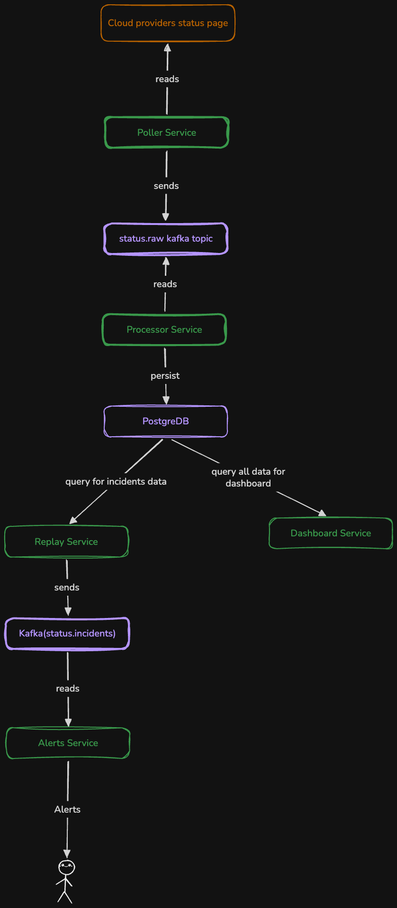

---

Experimenting with K8 StatefulSets By Bulding A Cloud Status Monitor
summary: Kubernetes, Golang, Python
---

To continuously feed my curisoities about k8 statefulsets, I came up with an architecture that would allow me get more hands on practice on my local machine on weekends.

Architecture
============

1. The poller service would call different cloud provider status api every 90s and publish the raw data to status.raw kafka topic.
2. The status.raw kafka topic acts as a buffer between poller and processor. status.raw keeps the raw data so the processor can replay the data even if it goes down 
3. The processor reads from the status.raw topic, normalize the data, remove duplicates and saves the data in postgre
4. Postgre is the source of truth. The database would store data about incidents, providers etc.
5. Relay service would query incident data from postgre and publish them to status.incidents topic
6. The Alerter service would read incident data from the status.incidents topic and just do a log to the console that looks like an alert
7. The dashboard service would only query data it needs to populate a dashboard.
